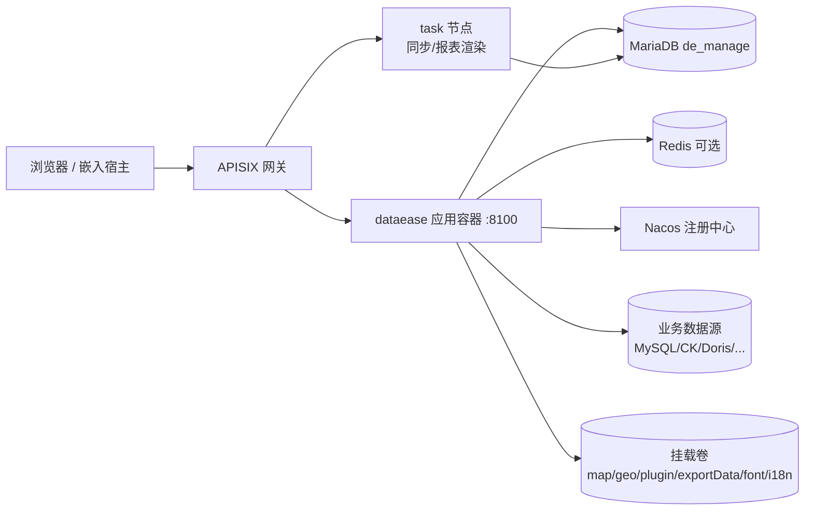
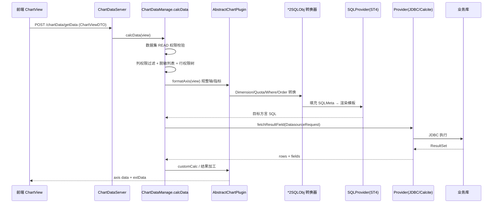

# DataEase V3 项目全面分析报告

> 扫描对象：`D:\dev\dataease`（DataEase V3.2.1，`dev-v3` 分支，commit `84212d333`）
> 扫描方式：静态源码阅读（目录结构、POM、配置、核心类调用链），未执行构建与启动
> 报告日期：2026-10-30

---

## 一、结论摘要

DataEase V3 是一套 **"元数据管理 + 虚拟语义层 + 可视化编排"** 的单体式 BI 平台：元数据落在关系库（MySQL/MariaDB/H2），业务数据不落地，查询时由后端把"图表配置"编译成目标库方言的 SQL 直连执行，跨源场景交由内置 Apache Calcite 完成联邦查询。

几个最关键的判断：

1. **架构主轴是"契约先行"**。`sdk/api/*` 只放接口 + DTO + 注解，`core/core-backend/*/server` 用 `@RestController implements XxxApi` 落地。前后端、开源/商业两套代码都围绕这套契约协作。
2. **开源核心 + 闭源 XPack 的双仓结构**，通过 `@XpackInteract(replace = true)` 在运行期替换核心的占位实现。当前工作区 `de-xpack` 子模块**为空**，因此权限、登录、组织、同步、报表、电子表格等能力只有契约没有实现。
3. **图表取数是全项目复杂度最高的链路**：`ChartDataManage.calcData()` → 图表 Handler 插件（按 `render-type` 注册）→ `SQLMeta` → 9 个 `*2SQLObj` 转换器 → StringTemplate 模板拼装 → Provider（JDBC/Calcite）→ 结果集二次加工。
4. **前后端规模失衡**：后端 Java 约 9.4 万行，前端 Vue+TS 约 40.7 万行（781 个 `.vue`、551 个 `.ts`），前端是本项目主要维护成本所在，也是图表插件化设计的重心。
5. **可运行的完整度受子模块制约**：单独 clone 主仓库无法获得完整体验；`CorePermissionManage.checkAuth()` 在无 XPack 时 `return true`，属于"社区版默认放行"的占位语义，集成时必须替换。

---

## 二、项目定位与功能全景

### 2.1 产品定位

面向业务人员的自助式 BI：连数据源 → 建数据集 → 拖拽做图表 → 拼仪表板/大屏 → 分享/嵌入/导出/订阅。宣传语为"人人可用的开源 BI 工具"，License 为 FIT2CLOUD Open Source License（GPLv3 + 品牌限制）。

### 2.2 功能域划分（按前端路由 + 后端包对应）

| 功能域 | 前端入口 | 后端包 | 说明 |
| --- | --- | --- | --- |
| 工作台 | `views/workbranch` | `home`、`visualization/manage/VisualizationStoreManage` | 最近使用、收藏、快捷入口 |
| 数据源 | `views/pages/toolbox` 等 | `datasource`（62 文件） | 连接管理、校验、驱动、内置引擎 |
| 数据集 | `views/visualized/data` | `dataset`（26 文件） | 直连表 / 自定义 SQL / 联合 / Excel / API |
| 图表 | `views/chart` | `chart`（58 文件） | 图表配置 CRUD + 取数 |
| 仪表板 | `views/dashboard` | `visualization`（78 文件） | 画布、联动、跳转、外部参数、水印 |
| 数据大屏 | `views/data-visualization` | `visualization` | 与仪表板同源，独立渲染管线 |
| 分享/嵌入 | `views/share`、`panel` 页 | `share`（17 文件） | 分享票据、JWT 链接令牌、iframe 嵌入 |
| 导出中心 | `pages/panel/ExportCenterWindow.vue` | `exportCenter`（10 文件） | 异步导出、下载票据、水印 |
| 模板市场 | `views/pages/template-market` | `template`（14 文件） | 应用模板、模板分类、版本 |
| 系统管理 | `views/system` | `system`、`menu`、`license` | 用户/组织/角色（XPack）、菜单、参数、许可 |
| 定时与同步 | — | `qrtz`（22 文件）、`job` | Quartz 调度骨架，同步实现属 XPack |
| AI 问数 | `views/sqlbot` | `ai`（1 文件） | 对接 SQLBot，前端内嵌 iframe/组件 |
| 三方集成 | — | 契约在 `api/wecom`、`api/dingtalk`、`api/lark`、`api/email`、`api/webhook` | 消息推送、扫码登录 |

---

## 三、仓库与模块版图

### 3.1 模块结构

```
dataease/                        (root pom, 只聚合 sdk)
├── sdk/
│   ├── common/                  公共内核：实体、认证注解、缓存、异常、i18n、迁移接口、工具
│   ├── api/
│   │   ├── api-base/            75 个 *Api 契约（chart/dataset/visualization/xpack/...）
│   │   ├── api-permissions/     权限契约（用户/组织/角色/菜单/行列表权限/APIKey）
│   │   └── api-sync/            同步契约
│   └── extensions/
│       ├── extensions-view/     图表扩展点：AbstractChartPlugin、DTO、FilterTree
│       ├── extensions-datasource/ Provider 抽象、SQLMeta、方言类型
│       ├── extensions-datafilling/ 填报扩展点
│       └── extensions-sync/     同步扩展点
├── core/
│   ├── core-backend/            Spring Boot 单体（Java 21）
│   └── core-frontend/           Vue 3 多页前端
├── de-xpack/                    闭源商业扩展（子模块，当前为空）
├── installer/                   docker-compose 编排、APISIX 网关、安装脚本
├── drivers/                     11 个 JDBC 驱动 jar
├── mapFiles/                    3394 个地图 GeoJSON
└── tests/                       13 组定向回归（Java/Node/Playwright）
```

### 3.2 规模统计（实测）

| 指标 | 数值 |
| --- | --- |
| Maven 模块（pom.xml） | 15 |
| Java 源文件 / 行数 | 1,197 / 约 94,500 |
| 前端 `.vue` / `.ts` | 781 / 551（约 407,000 行） |
| JPA 实体 / 显式表名 / Repository | 71 / 57 / 61 |
| REST 契约接口 / 实现类 | 75 / 26 |
| 图表前端插件文件 | 97 |
| 后端业务包 | 24（chart、dataset、datasource、visualization…） |

### 3.3 开源与商业边界（重要）

- `de-xpack` 由 `.gitmodules` 指向私有仓库，**本地为空目录**。
- 权限/登录/组织/同步/报表/电子表格的**接口**在 `sdk/api`，**实现**在 XPack。
- 核心侧用 `@XpackInteract(value = "corePermissionManage", replace = true)` 声明"可被替换"，注释与实现见 `core/core-backend/.../system/manage/CorePermissionManage.java`：

```java
@XpackInteract(value = "corePermissionManage", replace = true)
public boolean checkAuth(BusiPerCheckDTO dto) {
    return true;   // 无 XPack 时的社区占位语义
}
```

> 这意味着：**单仓构建出来的产物在鉴权上是"默认放行"的**。评估安全能力时必须连同 XPack 一起看，不能只看主仓库。

---

## 四、技术架构

### 4.1 技术栈

| 层次 | 选型 |
| --- | --- |
| 语言/运行时 | Java 21、Node + Vite 5 构建 |
| 应用框架 | Spring Boot 3.5.15；Spring Cloud 2023.0.1 + Alibaba（Nacos 注册发现，仅分布式形态） |
| 持久化（元数据） | Spring Data JPA + Hibernate + QueryDSL；MariaDB/MySQL（H2 桌面版）；`ddl-auto: update` |
| SQL 编译 | StringTemplate 4（`SqlTemplate` + `sqlTemplate.stg`）、JSQLParser 4.9 |
| 联邦查询 | Apache Calcite 1.35（跨源） |
| 调度 | Quartz（`scheduler-name: deSyncJob`） |
| 缓存 | JCache + EhCache 3（默认）/ Redis（可切换），统一封装 `DECacheService` |
| 实时通道 | Spring WebSocket（导出进度、消息推送） |
| 文档 | springdoc + Knife4j |
| 文件/导出 | Apache POI 5.5、Fesod、PDFBox、OpenPDF、flexmark |
| 报表截图 | Playwright 1.55 / Selenium 4.19（`docker-compose-playwright.yml`） |
| 前端 | Vue 3 + TypeScript + Element Plus（`element-plus-secondary` 分支包） |
| 可视化库 | AntV G2 5.x、G2Plot、L7 / L7Plot（地图）、S2（透视表）、ECharts 5、Univer（电子表格） |
| 其他前端 | axios、Pinia、TinyMCE、CodeMirror、html2canvas/jspdf |

### 4.2 运行时形态

`application.yml` 通过 `@profiles.active@` 注入，存在三套 profile：

| Profile | 元数据库 | 特征 |
| --- | --- | --- |
| `standalone` | MariaDB/MySQL（`dataeasev3`） | 默认单机部署，所有能力在一个 JVM |
| `distributed` | MariaDB（`de_manage`）+ 动态数据源 `de_official` | 启用 Nacos 注册；容器编排里多一个 task 节点 + APISIX 网关 |
| `desktop` | H2 文件库（`/opt/dataease3.0/desktop`，MODE=MySQL） | 绑定 `127.0.0.1`，桌面安装包形态，`flyway` 关闭 |

部署拓扑（分布式形态，见 `installer/dataease/docker-compose*.yml`）：



容器内挂载卷划分得很细（`data/map`、`data/geo`、`data/plugin`、`data/exportData`、`data/font`、`data/report`…），说明**运行期资源与镜像解耦**是刻意设计：地图、驱动、插件、字体都能热替换。

### 4.3 后端分层

```
sdk/api（契约：接口 + DTO + DePermit 注解 + OpenAPI 注解）
        ↓ implements
core-backend/{module}/server      HTTP 边界、参数校验、编排
        ↓
core-backend/{module}/manage      业务规则（事务边界多在此层）
        ↓
core-backend/{module}/dao         JPA Repository / QueryDSL / 少量 ext 查询
        ↓
extensions-datasource/provider    对外部数据源的物理访问
```

代表性实现：`DatasetDataServer implements DatasetDataApi`，方法体只做参数转交（`previewData` → `datasetDataManage.previewDataWithLimit(dto, 0, 100, false, true)`），业务全部下沉到 `manage`。这种"Server 薄、Manage 厚"的约定在全项目一致。

### 4.4 前端结构

- **多页构建**：`src/pages/{index,mobile,panel}` 三个入口，对应 `index.html` / `mobile.html` / `panel.html`；`config/pagesConfig.ts` 自动扫描目录生成 rollup input。`panel` 页承担"仪表板/电子表格预览 + 导出中心窗口"这类轻量宿主。
- **状态**：Pinia，`store/modules` 下 11 个模块，其中 `data-visualization/snapshot.ts` 是编辑器撤销/重做的核心。
- **权限路由**：`permission.ts` 做全局前置守卫，白名单含 `/login`、`/de-link`、`/chart-view`、`/admin-login`、`/401`；嵌入场景另有 `embeddedWindowWhiteList` / `embeddedRouteWhiteList`。
- **请求层**：`config/axios/` 分 `service.ts`（实例）、`refresh.ts`（令牌刷新）、`hmac.ts`（请求签名，`securityConfig` 动态加载，白名单 `/xpackModel`）。
- **自定义组件**：`custom-component/` 下 30 个画布元素（文本、图片、视频、Tab、时钟、装饰、分组…），是"大屏"能力的物料库。

---

## 五、核心功能逻辑链路

### 5.1 数据接入

- 数据源类型以**类**表达：`datasource/type/` 下 `Mysql`、`Oracle`、`Pg`、`Sqlserver`、`CK`、`Db2`、`Impala`、`StarRocks`、`Redshift`、`H2`、`Es`、`Mongo`、`GaussDB`、`Kingbase` 共 14 个配置模型，另有 API 数据源。
- 物理访问抽象为 `Provider`（`extensions-datasource/provider/Provider.java`），实现有 `CalciteProvider`、`MysqlEngineProvider`、`PgEngineProvider`、`OracleEngineProvider`、`SqlServerEngineProvider`、`StarRocksEngineProvider`、`H2EngineProvider`、`DmEngineProvider`、`KingbaseEngineProvider`、`EsProvider`。
- `ProviderFactory.getProvider(type)` / `getDefaultProvider()` 是唯一入口；**跨源场景强制走默认（Calcite）Provider**，这是代码里反复出现的分支判断。
- 内置引擎 `core_de_engine` + `EngineProvider` 提供"Excel 数据集落库"的宿主（把上传文件导入内置库再查）。
- 安全防护：`EngineProvider.validateIdentifier` 用正则拦截标识符中的引号/分号/方括号与控制字符，长度上限 64；`SQL_INJECTION_PATTERNS` 集中定义在 `engine/utils/Utils`。

### 5.2 数据集

`core_dataset_table.type` 的取值注释直接说明了四种形态：**`db` / `sql` / `union` / `excel` / `api`**。

- `DatasetSQLManage.getUnionSQLForEdit()` 是核心：把数据集（可能多层嵌套联合）展开成一段可执行的子查询 SQL，同时产出 `dsMap`（涉及的数据源集合）与 `isCross` 标记。
- 跨源时用 Calcite：`CalciteProvider.transSqlDialect()` 做方言转换，`getConnection()` 里按数据源类型逐个 `JsonUtil.parseObject(configuration, Xxx.class)` 反序列化配置——**配置即多态**，没有独立的配置表。
- 字段元数据在 `core_dataset_table_field`，计算字段用 `ExtFieldConstant.EXT_CALC` 标记，通过 `params` 携带公式。

### 5.3 图表取数（最核心链路）



要点：

1. **插件注册表**：`ChartHandlerManager` 用 `ConcurrentHashMap<"render-type", AbstractChartPlugin>`，key 形如 `antv-bar`；查不到则回落 `DefaultChartHandler`（`render=antv, type=*`）。前端插件用 `PluginsChartFactory.getInstance(render, type)` 处理 `isPlugin=true` 的自定义图表。
2. **SQL 生成不是字符串拼接**：先构造 `SQLMeta`（xFields / yFields / xOrders / table / customWheres / extWheres / whereTrees），再由 `SQLProvider` 把各部分塞进 `SqlTemplate.PREVIEW_SQL` 的 StringTemplate 模板。模板负责 `SELECT / WHERE / GROUP BY / ORDER BY` 的骨架，转换器负责片段。
3. **方言差异被收敛**：`Utils.isNeedOrder(dsMap)`、`Utils.replaceSchemaAlias`、`useAliasForGroup`、`notUseAs` 等开关，都是为不同数据库的 GROUP BY 别名、schema 前缀、ORDER BY 必填等差异准备的。
4. **结果加工在 Handler**：`DefaultChartHandler`（约 1000 行）承担同比环比、堆叠、透视、空值填充、排序等语义，是所有图表类型的公共父类。

### 5.4 仪表板与大屏

采用**草稿 + 快照**双写模型（这是本项目一个漂亮的设计）：

- 编辑态写 `visualization_*` 系列表（`visualization_linkage`、`visualization_link_jump`、`visualization_outer_params`…）。
- 发布/预览态写 `snapshot_visualization_*` 与 `snapshot_core_chart_view`，同名结构、前缀区分。
- `CoreVisualizationManage.innerSave/preInnerSave/innerEdit` 在写主表的同时拷贝一份到 snapshot 表，实现"编辑不影响已发布视图"。
- 移动/复制资源时 snapshot 同步搬迁，避免分享链接拿到半成品。

大屏（`data-visualization`）复用同一套后端，前端用独立的 `PreviewCanvas.vue` / `PreviewCanvasMobile.vue` 渲染管线，物料来自 `custom-component`。

### 5.5 分享与嵌入

- **票据（ticket）**：`ShareTicketServer` → `ShareTicketManage`，可对单个分享开启"需要票据"，票据有独立有效期与分页管理。
- **链接令牌**：`LinkTokenUtil` 用 `java-jwt` 签发，`TOKEN_VERSION = 4`，有效期 8 小时并取 `share.exp`、`ticketExpiresAt` 的最小值；claims 含 `purpose=link`、`shareId`、`resourceId`、`oid`、`ticketId`。注释明确写了"旧 token 未绑定票据身份，必须通过 proxyInfo 重新签发"——说明这里做过安全加固。
- **链路拦截**：`LinkInterceptor` + `DeLinkAop` + `ShareQueryScopeAop`，在请求进入时把分享身份注入上下文，并在查询层强制收紧数据范围。
- 分享资源鉴权与服务端渲染的边界，在 `tests/visualization-read-security/README.md` 有非常详细的约束说明（`findNameById` 只返回 id/name、拒绝匿名、不信任请求里的 `busiFlag`）。

### 5.6 导出中心

`ExportCenterManage` 是异步任务模型：`core_export_task` 记录任务（类型/状态/参数 JSON），`core_export_download_task` 记录下载凭证，下载走 `validateDownloadTask(id, ticket)` 二次校验。支持失败重试 `retry(id)`、按类型批量清理、Excel 水印注入（`addWatermarkTools`，写入当前用户信息）。任务并行度由 `ExportCenterLimitManage` 限制。

### 5.7 调度与同步

`qrtz` 包是标准 Quartz 11 张表的 JPA 映射（`QrtzTriggers`、`QrtzCronTriggers`、`QrtzFiredTrigger`…），`application.yml` 里 `quartz.scheduler-name: deSyncJob` 表明调度器专供同步任务。真正的同步执行器在 `extensions-sync` 契约 + XPack 实现中，主仓库只有骨架。

### 5.8 系统管理

`system` 包只有 9 个类：`CorePermissionManage`（占位）、`CoreUserManage`、`SysParameterManage`、`SysParameterServer` 及两张表（`core_sys_setting`、`core_typeface`）。用户/组织/角色的完整实现在 `api-permissions` 契约背后的 XPack，主仓库通过 `substitute/`（`SubstituteUserServer`、`SubstituteOrgServer`、`SubstitueLoginServer`）提供社区替代实现。**注意 `SubstitueLogin` 是拼写错误，但已是既有命名，不建议单独改名。**

---

## 六、关键设计决策评述

### 6.1 契约与实现分离（值得肯定）

`*Api` 接口自带 OpenAPI 注解与 `@DePermit` 表达式，实现类只加 `@RestController @RequestMapping`。好处：

- 前端可以从契约生成类型；XPack 与 Core 共享同一份方法签名，替换实现不需要改调用方。
- 权限点声明在契约上（如 `@DePermit({"#p0.datasourceId+':read'"})`），审计时"接口—权限"一一对应。

代价：契约层体积大（75 个接口），且**注解只声明不执行**——执行方在权限服务里，单看主仓库会产生"有注解就等于有鉴权"的错觉。

### 6.2 图表 Handler 的插件化

`AbstractChartPlugin` 同时被 `DefaultChartHandler` 和外部插件继承，注册靠 `@PostConstruct` 自注册。这套设计让新增图表类型只需：

1. 后端新增 Handler（或复用 Default）；
2. 前端 `views/chart/components/js/panel/charts/{g2,g2plot,map,table}` 下新增 `AbstractChartView` 子类；
3. 在 `index.ts` 注册。

前后端以 `render + type` 二元组对齐，是很务实的跨语言契约。

### 6.3 JPA 非空合并切面（双刃剑）

`JpaUpdateNonNullAspect` 拦截 `save/saveAndFlush/saveAll/saveAllAndFlush`，先查旧实体再合并非 null 属性。它解决的是"JPA 全字段更新导致 `createTime` 被 null 覆盖"的经典问题，但：

- 每次 `save` 多一次查询，`saveAll` 会逐项查询（AGENTS.md 已明确提示）；
- 它不等于 PATCH 语义，也不等于并发控制；
- 想真正清空字段必须绕开 `save`（QueryDSL 更新 / `@Modifying` JPQL）。

### 6.4 快照发布模型

编辑表 / 快照表分离，配合 `snapshot_core_chart_view`，是"所见即发布"的正确做法。代价是删除、移动、复制资源时必须在两套表上同步操作（`CoreVisualizationManage.delete/move` 里能看到逐表清理），漏一处就会出现"幽灵快照"。

### 6.5 缓存双实现

`DECacheService` 有两个实现：`DefaultCacheImpl`（JCache/EhCache）、`RedisCacheImpl`。语义差异要注意：JCache 在建缓存时设 TTL（`expTime <= 0` 默认 1 分钟），Redis 按键设 TTL（`<= 0` 不过期）。EhCache 配置里给权限相关缓存（`de_v3_user_roles`、`de_v3_user_busi_pers`、`de_v3_rsa`）单独定义了别名，说明这些是热点且必须可失效的。

### 6.6 多页 + 子应用嵌入

`index / mobile / panel` 三入口，配合 `lib` 式嵌入（宿主 iframe 加载 `/panel` 或 `/dvCanvas`）。相比单页应用，多页让"嵌入面板"不必背整个主应用的包体，但也带来代码重复（同一组件在三个入口各自打包）。

---

## 七、数据模型

按用途可分为六族（共 71 个实体、57 个显式表名）：

| 族 | 代表表 | 说明 |
| --- | --- | --- |
| 数据接入 | `core_datasource`、`core_datasource_task`、`core_de_engine` | `configuration` 字段用 `EncryptDecryptConverter` 加密存储（length 16MB） |
| 语义层 | `core_dataset_group`、`core_dataset_table`、`core_dataset_table_field` | `info` 存表/SQL 原始信息，`sql_variable_details` 存参数 |
| 图表 | `core_chart_view` | 图表配置整体存 JSON |
| 可视化 | `visualization_*`（10 张）+ `snapshot_*`（12 张） | 草稿 / 快照 |
| 系统 | `core_menu`、`core_sys_setting`、`core_typeface`、`core_font` | 菜单、参数、字体 |
| 运维 | `core_export_task`、`core_export_download_task`、`core_share_ticket`、`core_opt_recent`、`Qrtz*` | 导出、票据、最近访问、调度 |

ID 统一 `Long` + `SnowflakeUtil`；时间统一 `Long` 时间戳；表注释齐全（`@Comment`），实体用 `@Getter/@Setter` 而非 `@Data`（避免 JPA 关联递归）。

---

## 八、安全设计

| 层面 | 机制 | 位置 |
| --- | --- | --- |
| 接口鉴权 | `@DePermit(el 表达式)` + `@DeLinkPermit` | `sdk/common/auth` |
| 资源鉴权 | `BusiPerCheckDTO(datasetId, DATASET, READ)` → `CorePermissionManage.checkAuth` | `system/manage` |
| 行权限 | `PermissionManage.getRowPermissionsTree` → `WhereTree2Str.transFilterTrees` 注入 WHERE | `dataset/manage` + `engine/trans` |
| 列权限/脱敏 | `filterColumnPermissions(fields, desensitizationList, datasetId, userId)` | `dataset/manage` |
| 分享访问 | 票据 + JWT（含 ticketId 绑定）+ `ShareQueryScopeAop` 收紧查询 | `share/*` |
| 请求签名 | 前端 `securityConfig` 动态 HMAC | `config/axios/hmac.ts` |
| 密码/连接串 | `EncryptDecryptConverter`、`AesUtils`、`RsaManage`（`core_rsa` 密钥对） | `sdk/common` |
| 限流 | `@DeTraffic` + `DeTrafficAop` + `core_api_traffic` | `sdk/common/traffic` |
| 静态资源 | `StaticResourceSecurityInterceptor`、`StaticResourceContentGuard`、`HtmlResourceFilter` | `config` + `visualization/server` |
| 文件上传 | `ExcelFileGuard`、`ImageContentGuard`、`ExcelUtils` 限制 | `datasource/provider`、`utils` |
| SQL 注入 | 标识符白名单校验 + `SQL_INJECTION_PATTERNS` + JSQLParser 解析 | `engine/utils`、`commons/utils/SqlparserUtils` |

整体是"多层设防"的思路：接口层声明、服务层校验、SQL 层注入、资源层过滤。**但前提是 XPack 的权限实现到位**——主仓库的 `checkAuth` 恒真，属于必须补齐的一环。

---

## 九、工程化现状

### 9.1 构建

- 根 `pom.xml` **只聚合 `sdk`**，`core/pom.xml` 聚合前后端，`de-xpack/pom.xml` 单独聚合扩展。因此"根目录 `mvn package`"不等于完整产品构建。
- 前端三套构建模式：`build:base`、`build:distributed`，均以 `build:flush` 收尾（进入 `flushbonading` 目录装依赖并生成文件）。
- 后端有 `standalone / distributed / desktop` 三个 Maven profile，profile 决定打包进哪个 `application-*.yml`。
- 已配置 `flatten-maven-plugin`（`resolveCiFriendlyOnly`），配合 `${revision}` 式版本管理。

### 9.2 测试

- 前端**没有** `test` 脚本，只有 `ts:check`、`eslint`、`stylelint`。
- `tests/` 目录是 13 组"定向回归"，形态混合：Java 断言程序（`Regression.java` + `run.py`）、Node 脚本（`verify.mjs`）、Playwright 用例（`tests/browser`）、安装器检查。**不是** Surefire 体系，需手工编译运行。
- CI 只有三个 workflow：桌面构建（手动触发）、LLM 代码评审（qwen2.5-coder）、typos 拼写检查。**没有常规的构建/测试流水线**。

### 9.3 代码规范

`AGENTS.md`（24KB）把规范写得非常细：分层、字段更新语义、迁移、SQL 安全、前端快照通知、格式化命令、验证边界。这是该项目最值得借鉴的资产之一——它把"踩过的坑"变成了可执行的约束。

---

## 十、风险与技术债

按影响排序：

| # | 风险 | 影响 | 证据 |
| --- | --- | --- | --- |
| 1 | **子模块缺失** | 主仓库单独构建无法获得权限/登录/同步/报表能力 | `de-xpack/` 为空；`CorePermissionManage.checkAuth` 返回 true |
| 2 | **核心鉴权默认放行** | 若误将核心直接暴露，接口可能无鉴权 | 同上 |
| 3 | 配置含明文凭据 | `application-*.yml` 里写死 DB/Redis 密码、`sqlbot.aes-key`、`apisix-api.key` | `application.yml`、`application-standalone.yml` |
| 4 | 迁移双轨 | `flyway.enabled: false` + `ddl-auto: update` + 自研 `SqlBlock`；历史数据兼容靠人 | `application-*.yml`、`initSql` |
| 5 | MyBatis 残留 | 依赖 `mybatis-plus` 与 `mapper-locations` 配置，但项目内 **0 个** `@Mapper`、0 个 mapper XML | `pom.xml`、各 yml |
| 6 | 单文件过重 | `DefaultChartHandler` 1014 行、`CoreVisualizationManage` 1076 行、`ChartDataManage` 972 行 | 源码 |
| 7 | 前端体积大 | 40 万行、多页重复打包，构建需 8GB 堆（`--max_old_space_size=8192`） | `package.json` |
| 8 | 超大 JSON 字段 | `configuration`、`info` 等字段 16MB，缺结构化约束 | `CoreDatasource`、`CoreDatasetTable` |
| 9 | 缺少自动化测试门禁 | 回归靠手工脚本，重构风险高 | `.github/workflows`、`tests/` |
| 10 | 命名瑕疵 | `SubstitueLoginServer`、`ChartViewManege`（Manage 拼错） | 源码 |

---

## 十一、演进建议

**若要二次开发 / 私有化部署：**

1. 先初始化 `de-xpack` 子模块并确认许可，否则权限相关功能不可用；本地开发文档应显式写明这一点。
2. 把 `application-*.yml` 中的默认凭据改为环境变量占位（`${DE_DB_PASSWORD:}`），避免配置模板泄漏。
3. 统一迁移策略：要么启用 Flyway 并把 `SqlBlock` 收敛为 Flyway migration，要么明确 `ddl-auto` 仅用于开发。

**若要长期维护：**

4. 把 `ChartDataManage.calcData` 的"权限 → 轴 → 过滤 → SQL → 执行 → 加工"六段拆成可单测的协作对象，当前它把六件事揉在一个约 350 行的单方法里（所在类 972 行），是最大的重构收益点。
5. 为 `POST /chartData/getData` 建立黄金用例集（同一份 dataset + chart 配置，断言生成 SQL 与结果快照），这是回归成本最低的切入点。
6. 清理 MyBatis-Plus 依赖与配置，避免新同学误用。
7. 补齐 CI：至少 `ts:check` + 后端 `mvn -pl sdk -am install` + 关键 `tests/*` 脚本。

**若要扩展功能：**

8. 新增图表类型走"后端 Handler + 前端 AbstractChartView + 注册"三段式，不要往 `DefaultChartHandler` 里加 `if (type == ...)`。
9. 新增数据源只需实现 `Provider` + `type/Xxx.java` 配置模型 + 方言适配，无需改业务层。
10. 新增跨源能力时优先确认 Calcite 侧函数支持（`CalciteProvider.supportsWindowFunctions` 已有版本白名单逻辑可参考）。

---

## 十二、附录：关键文件索引

| 关注点 | 路径 |
| --- | --- |
| 启动类 | `core/core-backend/src/main/java/io/dataease/CoreApplication.java` |
| 图表取数编排 | `chart/manage/ChartDataManage.java`（`calcData`） |
| 图表 Handler 注册 | `chart/charts/ChartHandlerManager.java` |
| 默认图表实现 | `chart/charts/impl/DefaultChartHandler.java` |
| SQL 模板 | `engine/sql/SqlTemplate.java`、`resources/sql/sqlTemplate.stg` |
| SQL 拼装 | `engine/sql/SQLProvider.java` |
| SQL 片段转换 | `engine/trans/*2SQLObj.java`（9 个） |
| 跨源查询 | `datasource/provider/CalciteProvider.java` |
| 数据集联合 | `dataset/manage/DatasetSQLManage.java` |
| 仪表板快照 | `visualization/manage/CoreVisualizationManage.java` |
| 分享令牌 | `share/util/LinkTokenUtil.java` |
| 导出中心 | `exportCenter/manage/ExportCenterManage.java` |
| JPA 非空合并 | `config/JpaUpdateNonNullAspect.java` |
| 权限占位 | `system/manage/CorePermissionManage.java` |
| 前端图表插件 | `core-frontend/src/views/chart/components/js/panel/` |
| 前端快照 | `core-frontend/src/store/modules/data-visualization/snapshot.ts` |
| 请求拦截 | `core-frontend/src/config/axios/` |
| 多页配置 | `core-frontend/config/pagesConfig.ts`、`config/pages.ts` |
| 部署编排 | `installer/dataease/docker-compose*.yml`、`installer/dataease/apisix/` |

### 常用命令（仅在需要时执行，会写入 target/ 与 node_modules）

```bash
# 后端（根目录只聚合 sdk）
mvn -pl sdk -am install -Dmaven.test.skip=true
mvn -f core/core-backend/pom.xml package -Pstandalone

# 前端
cd core/core-frontend
npm ci
npm run dev        # 7070，代理 8100
npm run ts:check
```

---

**报告说明**：本报告基于静态阅读，未执行构建与运行验证。涉及 XPack 的部分（权限、登录、组织、同步、报表、电子表格）因 `de-xpack` 子模块为空，只能根据 `sdk/api` 契约与核心侧调用点推断其边界，具体实现细节需在子模块检出后补充。
